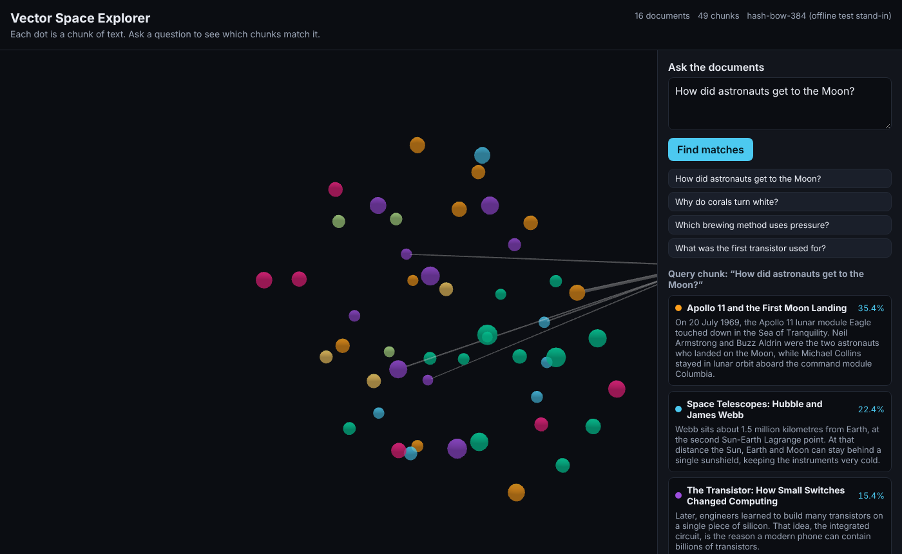

# Vector Space Explorer

See your documents as a 3D map of meaning. Every dot is a chunk of text. Ask a question and the
query appears on the map, with lines to the chunks that match it, ranked by similarity.



## What it shows

- **Ingestion:** documents are split into overlapping word windows (chunks), each chunk is turned into a
  384-number vector (an embedding) by a local model, and the vectors are projected into 3D with UMAP.
- **Query:** your question is embedded the same way, split into sentence groups, and compared with every chunk
  using cosine similarity. The top matches are listed and linked on the map.
- **Honest 3D:** UMAP squeezes 384 dimensions into 3, so distances on the map are approximate. Ranking uses
  the full vectors, so the list is always the true ordering.
- **Three ways to measure closeness:** a toolbar toggle switches between **Cosine**, **Euclidean** and **Map distance**.
  The vectors have length 1, so `d² = 2 − 2·cos` and cosine and Euclidean always rank identically (the toggle shows
  the angle and the chord between two vectors to explain why). Map distance ranks by the 3D dots instead, so
  where it disagrees with cosine you are seeing the projection's distortion.
- **Explore the map:** hover or click a dot to focus it and dim the rest, see its most similar chunks, fly the camera
  to it, hide documents from the legend, and use the toolbar for view presets, auto-rotate, labels and sliders.
  Keys: `Esc` clears, `R` resets the view, arrow keys step through matches.

## Run it locally

You need Python 3.10 to 3.14 (`onnxruntime`, which the embedder needs, has no wheels for 3.15 yet) and Node 20+. The first run downloads the embedding model (about 130 MB) once.

```bash
# 1. Backend
cd backend
python3 -m venv .venv && source .venv/bin/activate
pip install -r requirements.txt
cd ..

# 2. Frontend (build once, the backend serves it)
cd frontend
npm install
npm run build
cd ..

# 3. Start the app
cd backend
uvicorn app.main:app --port 8000
```

Open http://localhost:8000.

For frontend development with hot reload, run the backend as above and, in another terminal, run
`npm run dev` inside `frontend/`. Open http://localhost:5173.

## Use your own documents

Put `.md` or `.txt` files in `data/sample/` (or point `VSE_DATA_DIR` at another folder), then restart the server.
The first `# Heading` in a file becomes its title. The index is rebuilt in memory at startup and is not persisted.

## Configuration

| Variable | Default | Purpose |
|---|---|---|
| `VSE_DATA_DIR` | `data/sample` | Folder with `.md` / `.txt` documents |
| `VSE_EMBEDDER` | `fastembed` | `fastembed` = real local model. `hash` = offline stand-in for tests (lexical only) |
| `VSE_EMBED_MODEL` | `BAAI/bge-small-en-v1.5` | Any model supported by fastembed |
| `VSE_QUERY_RATE_PER_MIN` | `30` | Queries per minute per client IP |
| `VSE_NEIGHBOR_RATE_PER_MIN` | `120` | Similar-chunk lookups per minute per client IP |
| `VSE_CHUNK_MAX_WORDS` / `VSE_CHUNK_OVERLAP_WORDS` | `90` / `15` | Chunk size and overlap |

## Tests

```bash
cd backend
python -m pytest
```

The tests use the offline `hash` embedder, so they run without downloading a model.

## Architecture

- `backend/app/store.py`: the in-memory index (chunks, embeddings, 3D positions, UMAP reducer).
- `backend/app/main.py`: FastAPI routes `/api/health`, `/api/map`, `/api/query`, `/api/neighbors/{chunk_id}`, plus the
  built web app. Queries and neighbours return every chunk that is in the top k under *any* metric, each with its
  cosine, Euclidean and map-distance values and its rank under all three, so switching metric needs no new request.
- `frontend/src/Scene.tsx`: 3D view with `react-force-graph-3d` and fixed positions: focus and dim, fly-to, labels,
  the neighbourhood ring.
- `frontend/src/App.tsx`: query panel, ranked results, details, and the keyboard shortcuts.
- `frontend/src/Toolbar.tsx`, `Legend.tsx`, `PairGeometry.tsx`: map controls, document filter, and the angle/chord diagram.
- `frontend/src/settings.ts`, `focus.ts`, `metrics.ts`: the view settings (in memory), which nodes stay bright, and metric helpers.

## Limitations

- In-memory: the index is rebuilt on every start. Fine for a sample corpus, not for millions of chunks.
- Uploads are not part of the hosted demo. Run it locally to use your own documents.
- The query rate limit is in-memory and per process.

## License

MIT. See [LICENSE](LICENSE).
